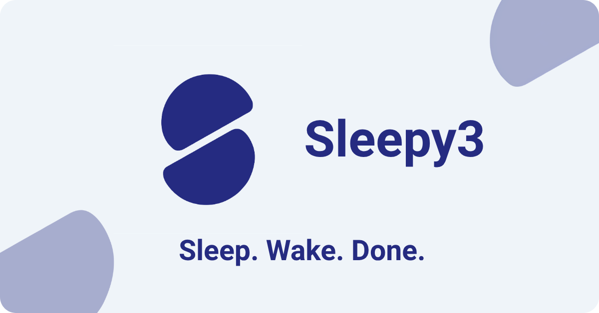

<p align="center">
  
</p>

<p align="center">
  <a href="https://github.com/Juankyyy/sleepy3/releases"></a>
  &nbsp;
  
  &nbsp;
  <a href="LICENSE"></a>
</p>

**Sleep tracking with one control and nothing to fill in.** Tap **Sleep** when you go to bed; the control shows the live sleep duration and a slide to wake until you get up. Sleepy3 keeps the exact times on your phone and stays out of your way.

## Why Sleepy3

- **Two moves.** Tap Sleep to start the night; slide to wake when you get up. No forms, no timers, no guessing.
- **A quiet timer while you sleep.** An ongoing notification shows the live elapsed time and when you will reach your eight-hour goal. It stays silent and disappears when you wake.
- **A reminder if you want one.** Choose a time in Settings and Sleepy3 sends a local notification so you do not forget to tap Sleep. It never fires while a night is already in progress.
- **Your last nights at a glance.** Home shows today, yesterday and the day before with a three-day average and bars against an eight-hour goal.
- **Nothing leaves your phone.** There is no account, no server of ours and no analytics. Health Connect is optional, and the reminder is scheduled on the device.
- **Designed for 3 a.m.** A big Sleep button, a slide to wake, one-hand use, a clear awake/sleeping state and light and dark themes that follow your phone.

## Download and install

Sleepy3 is not on Google Play yet. Download the latest stable build from [Releases](https://github.com/Juankyyy/sleepy3/releases). Releases are published manually; development builds are not distributed.

1. Open Releases on your phone.
2. Download the latest `sleepy3-vX.Y.Z.apk`.
3. Open the file and allow installs from your browser or file manager when Android asks.

Sleepy3 runs on **Android 9 or newer**. Version **0.3.0** is the latest stable release; the home-screen widget is planned for a later update.

## How to use it

1. Tap **Sleep** when you go to bed. The control shows the live sleep duration, a small slide to wake hint and a breathing moon; the header switches to a sleeping state and the clock keeps running. A quiet ongoing notification also shows the live timer and the goal time.
2. Slide to wake when you get up. Sleepy3 shows **Saving session** while it stores the night, then **Session saved**; the button returns to **Sleep** and shows how long you slept.
3. Open **Stats** to review or fix your history, use the plus button to add a night you forgot to track, and **Settings** for the theme, the 12/24-hour clock, the language, the nightly reminder and Health Connect.

Use the floating glass dock at the bottom to move between **Home**, **Stats** and **Settings**; the selected destination shows its label, and the content stays visible behind the dock.

Settings is split into **Appearance** (theme, 12/24-hour clock and language), **Stats** (the block shown in the Stats summary), **Reminders** (the optional nightly notification and the sleep status switch), **Sleep data** (Local or Google Health, and Import), **Google Health** (connection status, Sync and Add) and **About** (privacy, version and open-source licenses). The interface is available in **English** and **Spanish**; there is no separate “System” option, so the first launch resolves and stores the phone's language and you can change it later in **Appearance → Language**.

The reminder is **off by default**. Turn it on in **Settings → Reminders**, allow notifications when Android asks, and choose the time with the clock picker. Sleepy3 schedules the next notification on the phone; if you already tapped **Sleep**, it skips that reminder and rearms it when you wake up. Tapping the notification opens **Home** so the large Sleep button is one tap away. Changing the app language updates the notification text. On Android 13 and newer the permission is requested only when you enable the reminder; if you deny it, the switch stays off and the app offers to open the system notification settings. You can revoke it later in Android settings, and Settings will show a warning if notifications are blocked. Reminders are inexact by design: Android may deliver them a few minutes late, especially with battery saver. There is no push server and the notification contains no sleep data.

While a night is open, Sleepy3 also posts a **sleep status** notification: a silent, ongoing card with a custom compact layout. It shows the Sleepy3 mark, **Sleeping** and the live elapsed time as the main line, followed by the eight-hour goal time. At large system text sizes it falls back to Android's standard layout so the text stays readable. It uses its own **Sleep status** channel, so you can turn only that card off in Android without losing the reminder. Use the **Sleep in progress** switch in **Settings → Reminders** to turn it on or off; it is on by default. Turning it on asks for notification permission if needed, and turning it off hides the card immediately, even mid-sleep. It is independent from the nightly reminder. It disappears when you wake and keeps counting if the app process closes. On Android 13 and newer, the first **Sleep** tap asks for notification permission when you have not already allowed it; after a denial Sleepy3 does not ask again every night. The card reappears when you reopen the app if a night is still open. After a phone reboot it stays away until you open Sleepy3, because the app has no foreground service. Tapping it opens **Home**.

The header always tells you what is happening:

| Situation | What you see |
|---|---|
| Awake during the day | `No active session` |
| Awake at night | `Tap Sleep when you turn off the lights` |
| Sleeping | `Sleeping since 10:30 PM` |
| Just woke up | `Last session: 7h 45m` |

Day is 07:00–18:59 and night is 19:00–06:59, in local time. The clock, the session times and the time pickers use the `12-hour` or `24-hour` format chosen in Settings; until you choose one, Sleepy3 uses your phone's format and stores it. Home shows only the action that matches your state: **Sleep** while you are awake and the **slide to wake** while a night is open. The Sleep button takes the M3 pressed shape while you hold it; when the night starts, a soft light sweep crosses the control once and the moon settles into the sleeping row. While a night is open, the control shows the live duration (`3h 42m`, or `Just now` during the first minute) and a small slide hint; the moon and the arrow animate once when you enter the sleeping state. The slide must reach the end: the 104 dp button travels to the right and leaves a 50% trail of its own color, then it shows **Saving session**, then **Session saved**, before the Sleep button returns. After the action changes, Sleepy3 ignores drags and taps for a moment so a second gesture cannot close the session it just started.

Health Connect only accepts sleep sessions between 10 minutes and 24 hours. If a night falls outside that range, Sleepy3 asks first: you can keep sleeping, discard the session or move its start time.

## Stats

Stats groups nights by the day you woke up and offers **Week**, **Month**, **3 months**, **Year** and **All** ranges. The tonal insights button in the header opens the advanced dashboard, and the tab shows one summary block that you choose in **Settings → Stats → Stats summary**: your **Average sleep**, the four **Key metrics**, the **Sleep duration** chart, the **Sleep window**, the average **By weekday**, or **Key data** in a compact horizontal layout. The default is **Sleep duration**. The picker is a Material 3 modal with a real preview of each block for the current range, and the choice is saved on the device. The header action opens a draggable sheet over the same summary with every other metric, chart and insight, each with a spoken summary for screen readers; the block already shown in the summary is omitted, so the same data never appears twice. If the summary shows average sleep, the sheet keeps all five advanced blocks. The sheet opens at 70 % of the height, has a fixed header with its range and a close button, and scrolls as one surface. Drag the handle up to full height, down to 70 % and beyond it to close; the close button, the scrim and the system back gesture also close it. The 70 % resting point is a Sleepy3 design decision; M3 caps a modal sheet's initial position at 50 %. In the charts, press and hold a bar, a row or a weekday to see its tooltip; it stays visible until you tap anywhere else. Bars that reach the 8-hour goal use a darker tone; the rest are muted.

Each night is a tonal card with a ring that compares it with the 8-hour goal, replaced by a Material 3 Expressive clover badge once the goal is met; the Month, 3 months, Year and All views use a denser two-line card so more nights fit on screen. Sessions written by another app show an external-app arrow and that app's name, or **Another app** when Android cannot resolve it; your own sessions stay unmarked.

Pull down on Stats to refresh. The list stays in place while an M3 Expressive loader descends from the top; pending Google Health uploads are retried first, then the selected source is read again. In Local mode a refresh never uploads a new session. The advanced sheet reads the same live data; close it and pull down on the summary to refresh.

Tap any card to open it. Sessions written by the app you are using open in a detail view with the night's duration against the 8-hour goal, where you can change the start or end time or delete the session after confirming. Below the times, **Night summary** compares the session with your last seven nights and ranks it inside the selected range; read-only sessions show it too. The goal mark moves only in this view: once the goal is met the clover turns continuously, once every 8 seconds, while the crescent stays upright, and a shorter night draws its ring once on open. With Android's **Remove animations** enabled, both marks stay still. If Google Health needs write access, the delete dialog offers **Allow** and tries again. Sessions created by another app open read-only, with locked fields and a card that names the app when Android can resolve it (otherwise it says another app). In Local mode, sessions downloaded from Health Connect are read-only too. In Google Health mode, your own records stay editable even without a local copy. A record written by the other Sleepy3 build (release vs debug) is read-only from the build you are using, because Health Connect only lets the app that wrote it change it.

Use the round, primary-colored plus button beside the glass dock at the bottom of Stats to add a session you forgot to track. The dock and the button are centered as one group; the dock shifts a little to the left while you are in Stats, and the button slides in from the dock when the history is ready. The form starts with the last night (23:00 to 07:00, or up to the current time before 07:00), and dates cannot go past today. It applies the same rules as the editor: the wake time must be after the sleep time, a night lasts at least 10 minutes and less than 24 hours, neither time can be in the future, and it cannot overlap another session or the night in progress. In Google Health mode Sleepy3 saves the local safety copy first, then uploads it; if the upload fails the session stays pending for **Retry** and only Health Connect records appear in the visible list.

## Local or Google Health?

Choose the source in **Settings → Sleep data**.

| | **Local** (default) | **Google Health** |
|---|---|---|
| Where sessions are stored | Only in Sleepy3 | Health Connect, plus a local safety copy |
| What Stats shows | Only Sleepy3 sessions | Every sleep session in Health Connect, including other apps' |
| Editing | Only your Sleepy3 sessions | Records written by this build; other apps' records and the other Sleepy3 build are read-only |
| Good for | Keeping everything in one private app | Seeing all your sleep data together |

In Local mode Sleepy3 never touches Health Connect on its own. If you already sent a session there, editing it updates that record too.

In Google Health mode, the app asks for permission the first time. If you decline, it stays on Local. When a write fails, the session stays pending, a banner offers **Retry**, and Sleepy3 tries again when you reopen the app or pull down on Stats.

**Copy actions** in Settings:

- **Sync** sends your most recent pending session.
- **Add** sends every pending session.
- **Import** copies every Health Connect session into Sleepy3.

They never change the selected source, and repeating one does not create duplicates.

Health Connect hides records older than 30 days unless you give Sleepy3 the history permission. The app asks when you choose **3 months**, **Year** or **All** in Stats or start **Import**. If you decline, Stats keeps the last 30 days with an **Allow full history** button and the charts say **Last 30 days available**, and Import reports that it only copied 30 days.

## Your data

- Sessions, the theme, the 12/24-hour clock, the language, the data source and the reminder preference are stored in a local database on your phone.
- There is no account, no backend and no analytics. Nothing is sent to us.
- Local mode works completely offline. Health Connect is optional, and denying permission never blocks local tracking.
- Uninstalling Sleepy3 deletes the local database. If Android backup is enabled, the system may restore it when you reinstall.
- Sleepy3 talks to Health Connect on your phone, not to Google's cloud. A record that exists only in the Google Health cloud appears once Google Health syncs it to Health Connect.

## Common questions

**I reinstalled the app and my history is gone.** There is no account to sign in to. If Android did not restore the local database from a backup, earlier sessions cannot be recovered.

**Android won't install the APK over my old copy.** Android requires the same signing key. Uninstall the old app first; that also deletes its local database.

**Stats stops at 30 days.** Allow full history for Sleepy3 in Health Connect, then tap **Allow full history** in Stats or reopen the app. The 3 months, Year and All ranges need that permission.

**Health Connect is missing.** On Android 13 or lower, install the Health Connect app from the Play Store, then try again.

**The sleep reminder arrives late or not at all.** Reminders use Android's inexact alarm scheduling, so battery saver or aggressive OEM background restrictions can delay them. Allow Sleepy3 to run in the background and make sure notifications are enabled in Android settings. If you already tapped **Sleep**, the reminder is intentionally skipped for that night.

## What's next

- [x] Local tracking, Stats history and Settings.
- [x] Health Connect sync, history access and session editing.
- [x] First stable release (0.1.0).
- [x] Floating dock, new type and read-only session details (0.1.6).
- [x] Tonal Stats history, goal marks and the session panel (0.1.7).
- [x] Single Home action, Stats pull-to-refresh and goal motion (0.2.0).
- [x] Manual session entry from Stats (0.2.0).
- [x] English and Spanish, and a 12/24-hour clock setting (0.2.1).
- [x] Optional nightly sleep reminder with a chosen time (0.2.2).
- [x] Slide to wake, live sleep duration and saved feedback (0.2.2).
- [x] Silent sleep-status notification with a live timer and goal time (0.3.0).
- [x] Advanced Stats with five ranges, duration, window and weekday charts, insights and night context (0.3.0).
- [x] Customizable Stats summary block with real previews in Settings (0.3.0).
- [ ] Home-screen widget with Sleep and Wake buttons (0.4.0).
- [ ] Motion and accessibility polish.

## For developers

<details>
<summary><strong>Build, architecture, design and release process</strong></summary>

### Requirements

- An Android device or emulator running Android 9 (API 28) or newer.
- Flutter 3.47.x stable (Dart 3.13).
- JDK 17 or newer.
- Android SDK and platform tools. Android Studio is not required.

### Build and run

```bash
flutter pub get
flutter gen-l10n
flutter analyze
flutter test
flutter run

flutter build apk --release
```

The release APK is written to `build/app/outputs/flutter-apk/app-release.apk`. Install it with `adb install build/app/outputs/flutter-apk/app-release.apk`, or copy it to the phone and open it. On Windows, use the Flutter SDK's `bin\flutter.bat` or add `bin` to `PATH`.

`flutter run` installs **Sleepy3 Debug** (`com.sleepy3.app.debug`, version suffix `-debug`), which can coexist with a signed release APK and keeps a separate local database. Release APKs are signed with the project's release key; uninstall a debug-signed copy of `com.sleepy3.app` before installing a release build.

### Architecture

```text
lib/
├── main.dart
├── app/
│   ├── sleepy3_app.dart
│   └── splash_gate.dart  # zoom-out brand splash over the shell
├── core/
│   ├── theme/         # Material 3 Expressive theme and tokens
│   └── time/          # clock formatting, day/night rule and LocalDayBuilder
├── l10n/              # app_en.arb, app_es.arb and generated AppLocalizations
└── features/
    ├── sleep_tracking/
    │   ├── domain/        # sessions, durations, history, edit draft, store contract
    │   ├── data/          # Drift database and store implementation
    │   ├── application/   # Riverpod controllers, edit service and state
    │   └── presentation/  # home screen, header, live clock and buttons
    ├── stats/
    │   ├── application/   # shared range controller and permission flow
    │   └── presentation/  # summary, advanced sheet, charts, history list, editors
    ├── health/
    │   ├── domain/        # gateway, source, history access, sync store and stored session
    │   ├── data/          # Health Connect gateway, repositories and Drift sync store
    │   ├── application/   # source, history, history permission, sync, upload and copy
    │   └── presentation/  # copy dialogs, sync and history banners, source text
    ├── reminders/
    │   ├── domain/        # reminder value, next occurrence and scheduler contract
    │   ├── data/          # local notification and timezone scheduler
    │   ├── application/   # reminder controller and Home request
    │   └── presentation/  # Reminders section and switch row
    └── settings/
        ├── domain/        # theme, time format, language, app version and store contract
        ├── data/          # Drift settings store
        ├── application/   # theme, time format and language controllers, providers
        └── presentation/  # settings screen, appearance dialogs and about list
assets/
├── brand/             # logo sources, splash mark and launcher icon sources
└── fonts/             # Space Grotesk, the instanced Google Sans Flex titles face, OFL licenses
android/
└── app/src/main/kotlin/com/sleepy3/app/
    └── MainActivity.kt    # native widget and platform bridges land here
```

On launch, Sleepy3 opens the database, loads the open session, the saved theme, the 12/24-hour clock format, the language, the selected data source, the reminder preference and the installed version, then injects them into the Riverpod scope before the first frame. The first launch resolves the clock format and language from the phone and stores them. The closed history loads asynchronously from the selected source; a failed read falls back to an empty/default value instead of blocking startup.

The controller is a Riverpod `Notifier`: it updates in-memory state first so the buttons answer instantly, then serializes the disk write behind it. The UI never reads the database directly, and the clock is injected, which keeps the domain logic testable.

The reminder follows the same rule at a smaller scale: `SleepReminderController` serializes permission requests, scheduling and cancellation, and `Sleepy3App` calls it on launch, resume, Sleep/Wake changes and language changes. `LocalSleepReminderScheduler` keeps the platform and time-zone details behind the `SleepReminderScheduler` interface, so tests use a fake and never touch Android notifications.

### Tech stack

| Layer | Technology |
|---|---|
| UI | Flutter 3.47 + Material 3 Expressive (`material_3_expressive` 1.1.7) |
| Type | Space Grotesk for the M3 scale; instanced Google Sans Flex for the page titles (both OFL) |
| State | Riverpod (`flutter_riverpod` 3.x) |
| Localization | Flutter `gen-l10n` + ARB (`app_en.arb`, `app_es.arb`) |
| Persistence | Drift over SQLite (`drift`, `drift_flutter`) |
| App info | `package_info_plus` |
| Widget | `home_widget` + native Kotlin / Jetpack Glance (planned) |
| Health | Health Connect `SleepSessionRecord` |
| Reminders | `flutter_local_notifications` 22.3.3, `timezone` and `flutter_timezone` |
| Background | WorkManager for Flutter (future; reminders use AlarmManager) |

### Project conventions

- UI code imports `package:material_ui/material_ui.dart` and `package:material_3_expressive/material_3_expressive.dart`; never `package:flutter/material.dart`.
- `material_ui` is pinned to **1.7.0**. Version 1.8.0 adds a `RoundedPolygon` symbol that conflicts with `material_new_shapes`, used by `material_3_expressive` 1.1.7. Do not bump it until the packages are compatible.
- Drift generated code is committed. After changing the schema, bump `schemaVersion`, add a migration, then run `dart run build_runner build`.
- All user-facing copy lives in `lib/l10n/app_en.arb` and `app_es.arb`; run `flutter gen-l10n` after editing them and use `context.l10n` in widgets. The generated `lib/l10n/generated/` files are committed.
- Domain logic never calls `DateTime.now()`; the clock is injected through `sleepClockProvider`.
- Health Connect internals (stable client record ids, versions and deduplication) are documented in `SPEC.md §9`.
- `SPEC.md` holds the detailed behavior, data model and roadmap.

### Design and brand

Sleepy3 uses a fixed Material 3 Expressive palette taken from its logo: light body `#EFF4F9` with `#252B81` primary, and dark body `#121318` with `#C6CCF7` primary. Dynamic color (Material You) is intentionally off, so the app looks the same on every device.

Type is **Space Grotesk** for the M3 scale, bundled in the APK; the live clock uses it at weight 700. The home brand and the Stats/Settings page titles use **Google Sans Flex**, instanced at weight 900, width 112.5 and roundness 35, with only the optical-size axis left live. Both families are distributed under the SIL Open Font License (`assets/fonts/OFL-SpaceGrotesk.txt` and `assets/fonts/OFL-GoogleSansFlex.txt`); `assets/fonts/README.md` documents both assets. The launcher icon, the adaptive layers, the Android 12+ launch marks and the splash mark are generated from `assets/brand/` with:

```bash
dart run tool/generate_brand_assets.dart
```

Keep the native launch colors in `values/colors.xml` and `values-night/colors.xml` equal to `Sleepy3Theme.lightBackground` and `Sleepy3Theme.darkBackground`. The local M3 spec lives in `.agent-skills/m3-expressive/`; read its `SKILL.md` before changing UI.

### Releasing

Releases are created manually from `main` with `.github/workflows/release.yml`; there is no version bump commit.

- Pushes to `dev` or `main` publish nothing. The workflow only runs when the maintainer dispatches it from `main`.
- Choose `minor` (`v0.X.0`), `patch` (`v0.X.Y`) or `exact` (the version in `version`, e.g. `0.1.6`). `minor` and `patch` are computed from the highest existing tag; `exact` must be greater than it.
- The workflow runs `flutter analyze` and `flutter test`, builds a signed release, creates the tag and attaches `sleepy3-vX.Y.Z.apk` with a `.sha256`.
- Notes are generated from conventional commits since the previous tag. The curated body and `vX.Y.Z - The <Theme> Update` title are applied afterwards from `release-notes/vX.Y.Z.md` (ignored by Git):

```bash
dart run tool/apply_release_notes.dart v0.3.0
```

- Development builds are not published; use `flutter run` or a local APK to test `dev`.

Maintainers configure four repository secrets (`ANDROID_KEYSTORE_BASE64`, `ANDROID_KEYSTORE_PASSWORD`, `ANDROID_KEY_ALIAS`, `ANDROID_KEY_PASSWORD`). Without them the workflow fails instead of publishing a debug-signed APK. See `SPEC.md §1`.

### Contributing

Work happens on `dev`; `main` stays stable. Commits follow Conventional Commits with a scope, in English:

```text
feat(ui): add history summary
fix(data): restore an open session
docs(spec): define the widget contract
```

A module is done when `flutter analyze` is clean, `flutter test` passes, the Android debug build succeeds, new behavior has tests, and `SPEC.md` / `README.md` are updated when the change affects behavior or the user experience.

### Development troubleshooting

- **`flutter` is not recognized on Windows**: call `<flutter-sdk>\bin\flutter.bat` or add `<flutter-sdk>\bin` to `PATH`.
- **Dependency resolution fails after bumping `material_ui`**: the pin exists on purpose; stay on 1.7.0 until `material_3_expressive` supports the newer symbol.

</details>

## License

Sleepy3 is free software, distributed under the terms of the **GNU General Public License, version 3**. See [LICENSE](LICENSE) for the full text.

This program comes with ABSOLUTELY NO WARRANTY. You are welcome to redistribute it and modify it under certain conditions; the license explains them.
